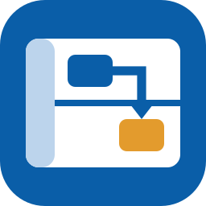
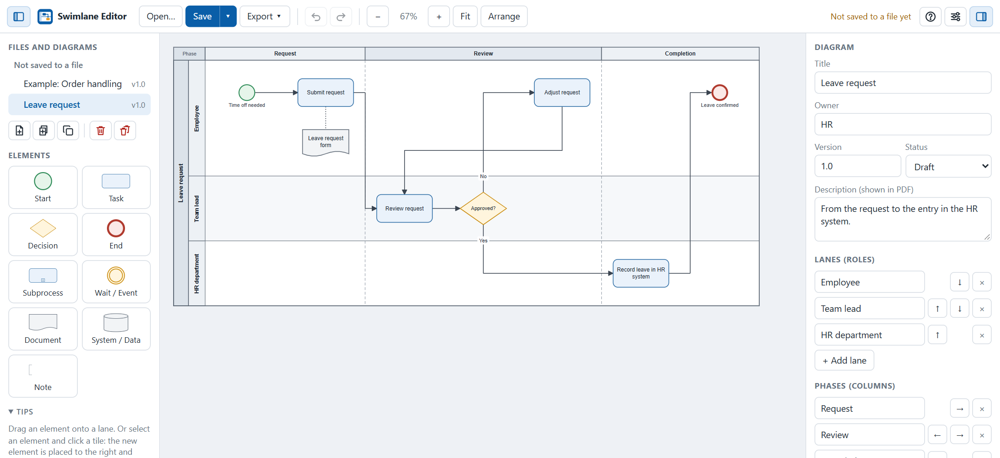

#  Swimlane Editor

**Swimlane process diagrams in one HTML file – offline, no installation, saved as draw.io.**

Swimlane Editor shows who does what, in which order: roles as lanes, steps and decisions, phases from left to right. It runs in the browser without a server or an internet connection. Diagrams are saved as `.drawio` files, which draw.io opens as well, and export to PDF and SVG.

  

## What it does

- **Lanes, phases and elements** – Start, Task, Decision, End, Subprocess, Wait/Event, Document, System/Data, Note; connections for sequence flow, messages and associations.
- **Arrange automatically** (`L`) – puts the steps in order and keeps lanes and phases.
- **draw.io as the file format** – edit a diagram in draw.io and open it here again.
- **PDF** – A4 landscape with logo, title, version and owner; on one page or split across several at readable size. A file with several diagrams becomes one PDF; the Export menu also makes one PDF of all diagrams.
- **Diagrams with AI** – an AI writes the steps as JSON, the editor lays them out; the guide for the AI is in the help (`H`) to download, and in [`docs/AI-DIAGRAMS.md`](docs/AI-DIAGRAMS.md).
- **Keyboard first** – undo/redo, copy/paste, multi-select, align; `H` lists every key.

## Start

Download `swimlane-editor.html` from [Releases](https://github.com/fly2nbc-oss/Swimlane-Editor/releases) and open it in Chrome or Edge. Nothing to install.

On Windows you can add it to the Start menu instead: unpack `swimlane-editor_<version>_windows-installer.zip` and run `install.cmd`. It installs for the current user without admin rights, opens the editor in its own Edge window and adds an entry to *Settings > Apps* to remove it. Running `install.cmd` of a newer version updates it. The script is not signed, so Windows may ask whether to run it (*More info > Run anyway*).

| Action | How |
|---|---|
| Add element | Drag a tile onto a lane, or double-click an empty spot |
| Add next step | Select an element, click a tile: placed to the right and connected |
| Connect | Drag from a blue dot of an element to another element, or click the dot, scroll if needed, and click the other element (`Esc` cancels), or select two elements with `Shift` + click and press `C` |
| Edit text | Double-click, or `Enter` |
| Several elements | `Shift` + click or drag a box around them; the right panel aligns, distributes, sizes them and sets type, color or lane for all |
| Save / open | `Ctrl+S` / `Ctrl+O` – after the first save, `Ctrl+S` writes to the same file; diagrams opened from one file (draw.io pages or a JSON list) are saved together as pages of one `.drawio` file |

Firefox and Safari cannot write files directly: **Save** downloads the file instead.

## Your data and privacy

The `.drawio` file is the document. The browser also keeps a working copy of the diagrams and the settings, which clearing the site data removes. Swimlane Editor loads nothing from the internet and has no telemetry. The only request is the update check: at most once a week it asks GitHub for the latest release of Swimlane Editor and shows a notice when there is a newer one. Nothing from your diagrams is sent. Switch it off in **Settings**.

## More

- Building from source: [`CONTRIBUTING.md`](./CONTRIBUTING.md) · Changes: [`CHANGELOG.md`](./CHANGELOG.md) · Security: [`SECURITY.md`](./SECURITY.md)
- License: Apache 2.0 ([`LICENSE`](./LICENSE)), third-party components in [`THIRD_PARTY.md`](./THIRD_PARTY.md)

draw.io is a trademark of JGraph Ltd., named only to describe file compatibility; this project is not affiliated with JGraph.
